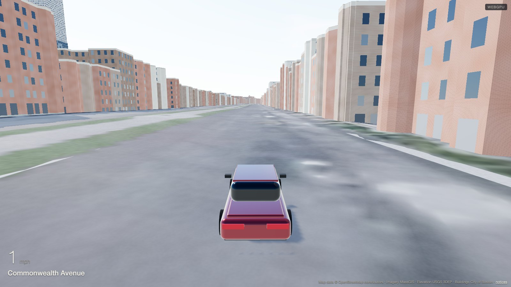
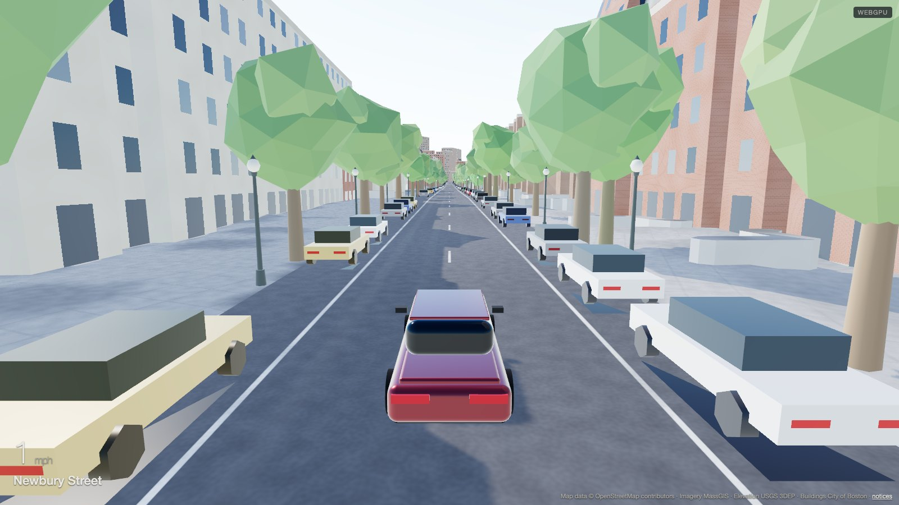
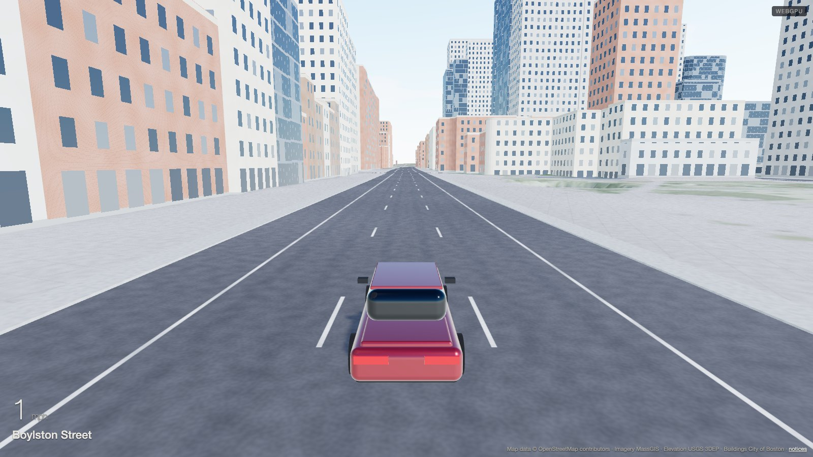
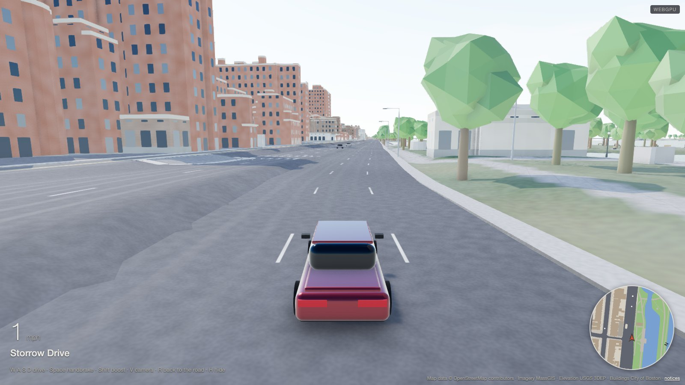
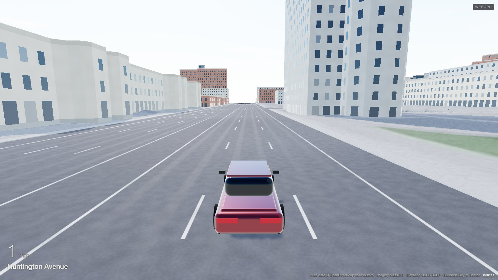
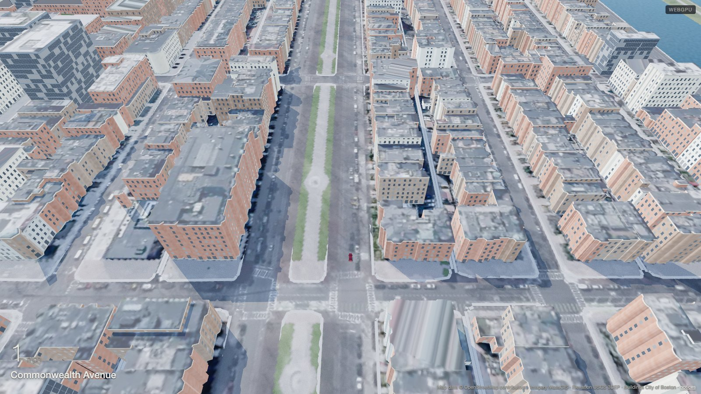

# Drive Boston

A browser driving game set in the real streets of Boston. The street network,
curbs, building footprints and heights come from public geographic data; the
ground and roofs are textured with public-domain aerial imagery; facades are
procedural. The car is a generic sedan on a rigid-body vehicle model.

Play it at https://markleary.github.io/driveboston/

## Status

Proof of concept: Back Bay only (Massachusetts Avenue to the Public Garden,
the Charles to Huntington Avenue), daytime only, no traffic. The streets,
curbs, bridges, underpasses and 5,000 buildings are the real ones at their
real heights, the ground is the 2025 aerial imagery, and the car collides with
all of it. See [docs/decisions.md](docs/decisions.md) for the direction and
[docs/perf-log.md](docs/perf-log.md) for measurements.

| | |
|---|---|
|  |  |
|  |  |
|  |  |

Screenshots are captured by the browser test (`npm run test:e2e`), so they
track the current build.

## Controls

| Key | Action |
|---|---|
| W / S or arrows | Throttle and brake or reverse |
| A / D or arrows | Steer |
| Shift | Boost |
| Space | Handbrake |
| R | Reset the car to the nearest road |
| V | Cycle camera (chase, first person, aerial) |
| H | Hide or show the HUD |
| Mouse drag and wheel | Orbit and zoom the chase camera |
| ` (backtick) | Developer overlay and tuning panel |

URL options: `?spawn=Newbury` starts at the first spawn whose name contains the
text (the spawn list is in the developer overlay's hooks), `?dev` opens the
developer tools, `?webgl` forces the WebGL 2 renderer.

## Running locally

Requires Node 24.

```bash
npm ci
npm run dev
```

The dev server runs at http://127.0.0.1:5188/driveboston/.

Other commands: `npm test` (unit tests), `npm run test:e2e` (browser tests:
smoke, a scripted lap of Back Bay and the screenshots; needs
`npx playwright install chromium` once; hosted CI has no GPU and runs only
the smoke tests, against the production build), `npm run build`
(static site in `dist/`), `npm run check` (refuses secrets and other forbidden
content), `npm run geo -- --box backbay` (rebuilds the world data from the
downloaded sources, see `tools/`).

## Technology

three.js (WebGPU renderer with a WebGL 2 fallback, node materials), Rapier
physics, Vite, TypeScript, Vitest and Playwright. No backend; the whole game is
a static site.

## Data and attribution

Every data source, its licence and the required attribution is listed in
[NOTICE.md](NOTICE.md). Map data © OpenStreetMap contributors (ODbL). Aerial
imagery and elevation from MassGIS and the USGS 3D Elevation Program. Building
and street data from the City of Boston (Analyze Boston, PDDL).

## Licence

Code is MIT licensed (see LICENSE). Derived data files carry the licences of
their sources as described in NOTICE.md.
